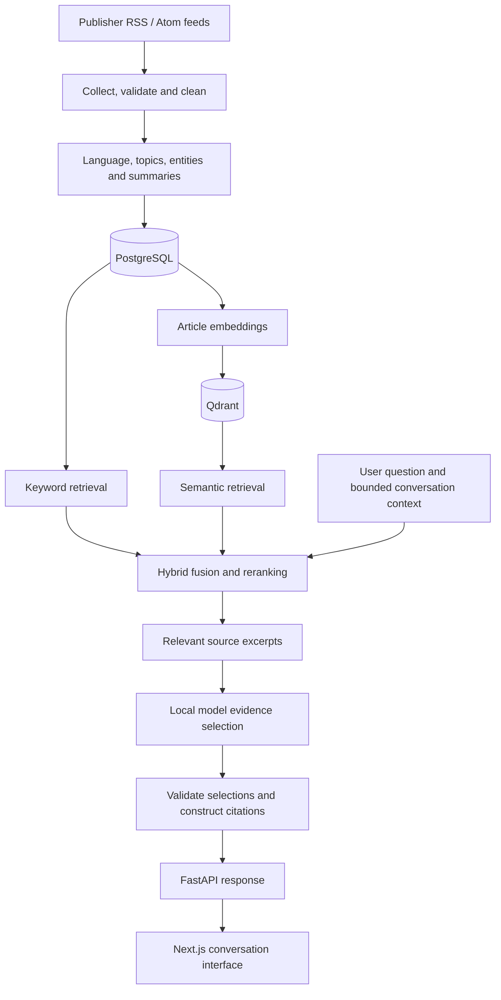

<div align="center">

# NewsLens AI

### News intelligence with evidence you can inspect.

Collect reporting. Search across sources. Ask questions with citations.

[](https://github.com/sean8911/NewsLens-AI/actions/workflows/ci.yml)   

[Getting started](docs/getting-started.md) · [Architecture](docs/architecture.md) · [Model setup](docs/model-setup.md) · [Development](docs/development.md)

</div>

---

## Overview

NewsLens AI connects news collection, information retrieval and a citation-grounded chatbot in one application. It collects articles from configurable RSS feeds, enriches them with NLP, groups related reporting into events, and lets readers search or ask follow-up questions against the collected evidence.

The application uses **FastAPI**, **PostgreSQL**, **Qdrant** and **local models**, with a **Next.js** interface. Chat and shared navigation support **English and Chinese**; retrieval and answer processing support **English, Malay and Chinese**.

## Capabilities

| Area | What it provides |
| --- | --- |
| News collection | Scheduled RSS/Atom ingestion, URL deduplication, cleaning, optional content extraction and persisted update outcomes. |
| Hybrid retrieval | PostgreSQL full-text search and Qdrant vector search, reciprocal rank fusion, cross-encoder reranking and recency-aware ranking. |
| Grounded conversation | Source-linked answers, inspectable excerpts, saved conversations, contextual follow-ups and explicit insufficient-evidence states. |
| Article analysis | Language detection, multi-label topics, named entities, keywords and extractive summaries. |
| Event intelligence | Related-article clustering, cited event summaries, publisher comparisons, reporting timelines and corpus-based trends. |
| Reading experience | Responsive Metro Focus interface, bilingual chat controls and separate publication/collection timestamps. |
| Evaluation | Fixed retrieval/RAG fixtures, evaluation runners, performance telemetry and automated regression checks. |

## Architecture



PostgreSQL remains the source of truth. Qdrant stores derived article vectors; an article can be collected successfully while its model processing or vector indexing still needs reconciliation.

### How RAG works here

1. **Retrieve** relevant articles through lexical and semantic search, preserving source/date filters.
2. **Rank** candidates with reciprocal rank fusion, a cross-encoder and the applicable recency policy.
3. **Build context** from bounded source excerpts, identifiers and timestamps.
4. **Select evidence** with the local model and validate its output against the supplied context.
5. **Return a grounded response** with citations, original excerpts and translations when requested. Return an explicit insufficient-information state when usable support is absent.

The answer contract emphasizes validated evidence selection. Citations make support inspectable; they do not guarantee that a response is complete, relevant or the newest available account. Follow-ups retrieve evidence again, while saved answers retain their original source dates.

## Technology stack

| Layer | Technologies |
| --- | --- |
| Frontend | Next.js, React, TypeScript, Tailwind CSS, Lucide |
| API and validation | FastAPI, Uvicorn, Pydantic |
| Relational storage | PostgreSQL, SQLAlchemy, pg8000, Alembic |
| Vector retrieval | Qdrant, Sentence Transformers |
| Model runtime | PyTorch, ONNX Runtime, local model adapters |
| Multilingual retrieval | multilingual-e5-small, bge-reranker-v2-m3 |
| Evidence selection / translation | Qwen2.5-1.5B-Instruct, M2M100 418M |
| Collection and scheduling | feedparser, Requests, APScheduler |
| Quality checks | pytest, Ruff, Playwright, ESLint, TypeScript, GitHub Actions |

Configured model identifiers and revisions are documented in [`.env.example`](.env.example). Weights are downloaded explicitly and are not stored in this repository.

## Getting started

### Prerequisites

- Python **3.11+**.
- PostgreSQL and an application database. A separate database is required for integration tests.
- Node.js satisfying [`frontend/package.json`](frontend/package.json), plus **pnpm 11.19.0**.
- Disk space and a compatible runtime for the configured local models.

**Docker is optional.** The native Windows/PowerShell workflow is documented below and in the [complete setup guide](docs/getting-started.md).

### 1. Install

```powershell
git clone https://github.com/sean8911/NewsLens-AI.git
cd NewsLens-AI

python -m venv .venv
.\.venv\Scripts\python.exe -m pip install --upgrade pip
.\.venv\Scripts\python.exe -m pip install -e '.[dev]'

if (-not (Test-Path .env)) { Copy-Item .env.example .env }
npm install -g pnpm@11.19.0
Push-Location frontend
pnpm install --frozen-lockfile
Pop-Location
```

### 2. Prepare storage, models and articles

Follow [database setup](docs/database.md) to configure PostgreSQL and apply migrations, then [model setup](docs/model-setup.md) to download the pinned snapshots, collect articles and synchronize indexes.

The checkout contains source and evaluation fixtures. Your local application database and model weights must be prepared separately. An empty corpus has no evidence for news answers.

### 3. Run in three terminals

Run these commands from the repository root after setup.

**Terminal 1 — automatic news updates**

```powershell
# For the isolated Windows database provisioned by the setup helper:
.\.venv\Scripts\python.exe scripts/local_postgres.py start
.\.venv\Scripts\python.exe -m ingestion.scheduler run
```

For an existing PostgreSQL service, start that service instead of the helper. Keep the worker running for periodic collection; the example configuration schedules updates every ten minutes.

**Terminal 2 — API**

```powershell
.\.venv\Scripts\python.exe -m backend.app.api_cli --port 18000
```

**Terminal 3 — website**

```powershell
$env:NEWSLENS_API_URL = "http://127.0.0.1:18000"
.\.venv\Scripts\python.exe scripts/run_frontend.py
```

| Service | Local address |
| --- | --- |
| Chat website | http://127.0.0.1:3000/chat |
| Interactive API documentation | http://127.0.0.1:18000/docs |
| Process liveness | http://127.0.0.1:18000/health |
| Database and collection status | http://127.0.0.1:18000/system/status |

`NEWSLENS_API_URL` is a server-only frontend setting. The frontend defaults to API port 8000 when it is unset; set it explicitly for the 18000 workflow. Reuse a running instance or choose free ports if a service is already listening.

## API example

With the API, database, index and models ready, ask about a topic present in your collected articles:

```powershell
$question = @{
    question = "What does the collected reporting say about artificial intelligence?"
    answer_language = "en"
} | ConvertTo-Json

Invoke-RestMethod -Uri "http://127.0.0.1:18000/chat" `
    -Method Post -ContentType "application/json" -Body $question
```

The structured response includes an answer status and sources when available. `insufficient_information` is a valid outcome when the selected corpus does not support the question. Explore search, articles, conversations, events and research endpoints in the generated API documentation.

## Configuration and freshness

| Setting or file | Purpose |
| --- | --- |
| `NEWSLENS_DATABASE_URL` | Application PostgreSQL connection; configure privately. |
| `NEWSLENS_TEST_DATABASE_URL` | Dedicated integration-test database. |
| `NEWSLENS_API_URL` | Server-side frontend connection to FastAPI. |
| `NEWSLENS_SCHEDULER_ENABLED` | Enables the separately started update worker. |
| `NEWSLENS_SCHEDULER_INTERVAL_SECONDS` | Collection interval; 600 seconds in the example. |
| `NEWSLENS_QDRANT_PATH` / `NEWSLENS_QDRANT_URL` | Local vector storage or an optional Qdrant server. |
| `ingestion/feeds/defaults.json` | Publisher feeds and their configured categories. |
| `.env.example` | Model revisions, limits and remaining configuration options. |

For an update check or a single intentional collection:

```powershell
.\.venv\Scripts\python.exe -m ingestion.scheduler status
.\.venv\Scripts\python.exe -m ingestion.scheduler once
```

Opening the website does not start collection. Feed availability, article dates and successful index synchronization determine freshness. New collection does not rewrite saved answers.

## Testing and evaluation

The [CI workflow](.github/workflows/ci.yml) checks workflow syntax, Python lint and tests with native PostgreSQL, and frontend lint/build/types/tests. The badge above links to the actual workflow status.

```powershell
# Backend lint and offline tests
.\.venv\Scripts\python.exe -m ruff check backend ingestion nlp tests scripts infra/docker
.\.venv\Scripts\python.exe scripts/run_tests.py --suite offline

# Full acceptance requires the dedicated configured test database
.\.venv\Scripts\python.exe scripts/run_tests.py --suite all

# Frontend checks
Push-Location frontend
pnpm lint
pnpm build
pnpm typecheck
pnpm test
Pop-Location
```

Tests use controlled providers where appropriate. Passing these checks does not establish live feed coverage or real-model inference on every host. The fixed evaluation corpus is separate from the current news database; measured answer quality needs its own evaluation. See [development and testing](docs/development.md) for scope and port configuration.

## Repository layout

```text
backend/       API, retrieval, chat, events, persistence and migrations
frontend/      Next.js application, bundled assets and frontend tests
ingestion/     Collection, cleaning, extraction and scheduling
nlp/           Article analysis, embeddings, translation and model adapters
tests/         Python unit and PostgreSQL integration tests
scripts/       Local startup and validation utilities
infra/         Optional container tooling
requirements/  CI dependency requirements
docs/          Maintained setup, architecture and development guides
.github/       Continuous integration
```

## Documentation

| Guide | Contents |
| --- | --- |
| [Getting started](docs/getting-started.md) | Installation, startup and troubleshooting. |
| [Database setup](docs/database.md) | PostgreSQL configuration, migrations and the isolated Windows helper. |
| [Models and indexing](docs/model-setup.md) | Downloads, local providers, collection and backfills. |
| [Architecture](docs/architecture.md) | Data flow, RAG boundaries and operational decisions. |
| [Development](docs/development.md) | Tests, CI, evaluation and generated outputs. |
| [Contributing](CONTRIBUTING.md) | Reproducing issues, changing code and validating contributions. |

## Operating boundaries

- Answers use the collected corpus. Dedicated live weather, shopping-price lookup and per-question web browsing are not connected.
- Neural retrieval and chat require prepared models and a working runtime. A running UI or a healthy liveness endpoint does not verify inference.
- Relevance, completeness and freshness depend on source coverage, extraction, retrieval and evidence selection. Inspect the cited text and dates.
- The default setup binds to loopback for local use. Public hosting requires deployment-specific authentication, TLS and operational controls.
- Article content remains attributable to its publishers. Model and bundled asset licenses continue to apply; retain the Manrope font license.

Private configuration, model files, local databases, saved conversations and generated diagnostics are excluded from version control.
